<picture>
<source media="(prefers-color-scheme: light)" srcset="https://github.com/mirion-dev/mirion-dev/blob/output/stats.svg" />

</picture>

 
 

<picture>
<source media="(prefers-color-scheme: light)" srcset="https://github.com/mirion-dev/mirion-dev/blob/output/top-langs.svg" />

</picture>

 
 

<table>

<tr>
<td>
Primary
</td>
<td>

</td>
</tr>

<tr>
<td>
Secondary
</td>
<td>

</td>
</tr>

</table>

<picture>
<source media="(prefers-color-scheme: light)" srcset="https://github.com/mirion-dev/mirion-dev/blob/output/snake.svg" />

</picture>

